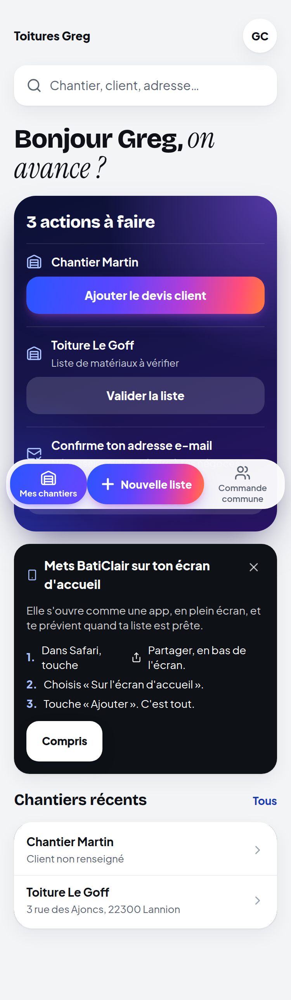
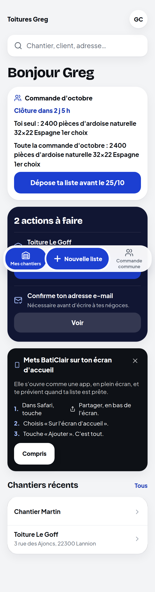
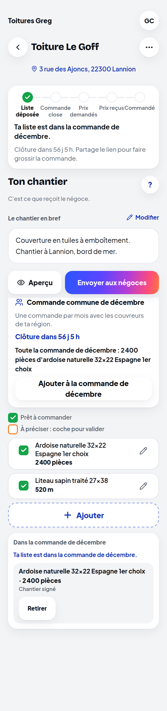
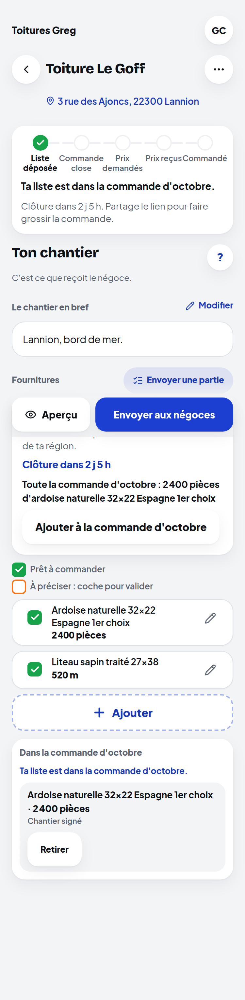
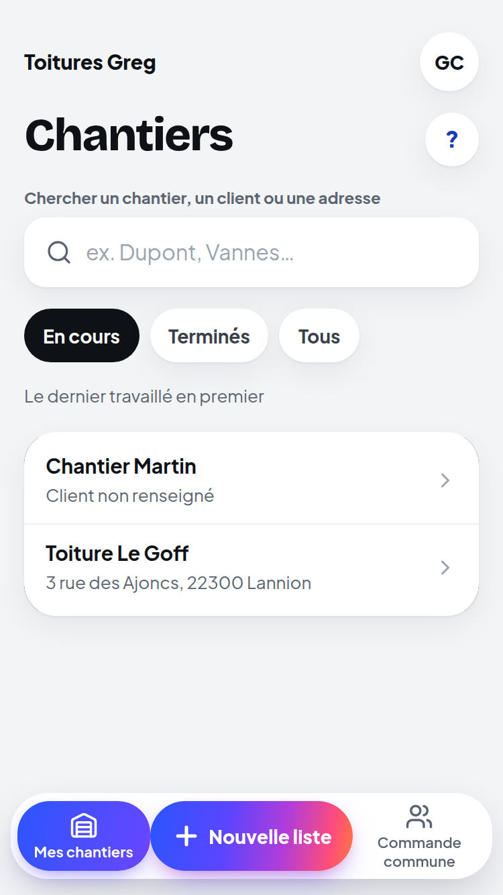
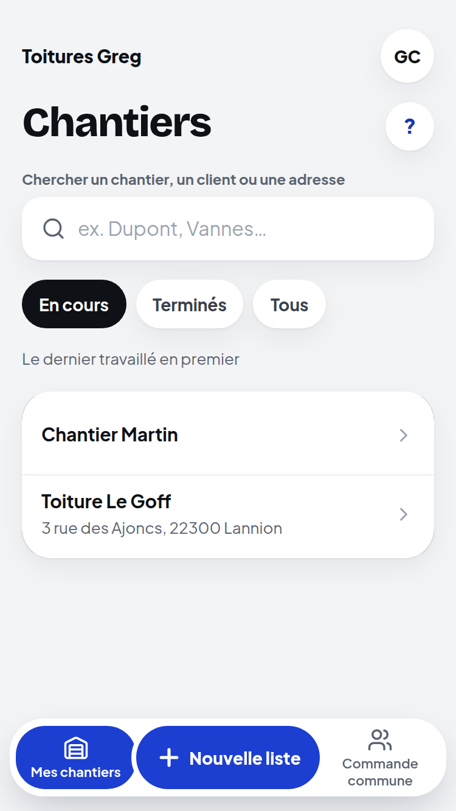
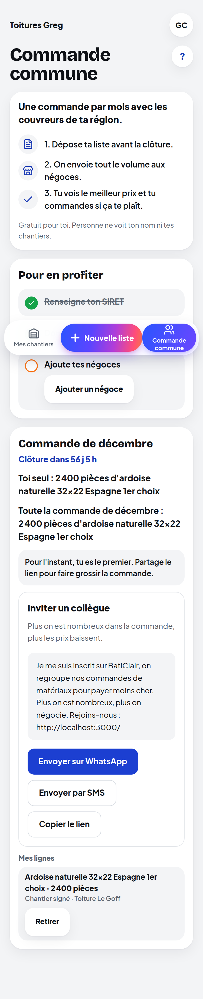
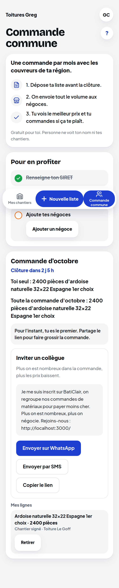

# Retours iPhone de Greg (23 octobre 2026)

Branche `claude/saas-achat-artisans-prompt-1lyihx` (PR #284), reportée sur `claude/integration-groupe`. Rien dans `main`. Captures iPhone SE (375 × 667) prises sur le même parcours avant et après : `captures/retours-23-10/avant/` et `captures/retours-23-10/apres/`.

## Point par point

| # | Retour | Avant | Après |
|---|---|---|---|
| 1 | Accueil : la commande du mois en haut | Rien sur la commande ; la carte « À faire » proposait « Ajouter le devis client ». | Bloc « Commande d'octobre » au-dessus de tout : « Clôture dans 2 j 5 h », « Toi seul : … » (si l'entreprise a déposé), « Toute la commande d'octobre : … » (ou « Pour l'instant, la commande est vide. Ta liste peut la lancer. »), bouton « Dépose ta liste avant le 25/10 » vers « Nouvelle liste ». Le département est celui de l'entreprise, sinon celui du dernier chantier adressé. |
| 2 | Restes de l'ancienne logique | « Ajouter le devis client », « X offres reçues / Comparer les offres », « on avance » par chantier. | En mode mois, l'API ne rend plus ces actions (`next-actions`), « Ton chantier » n'affiche plus la comparaison d'offres. Tout reste en mode `lots`. |
| 3 | « Client non renseigné » | Sous chaque chantier sans client. | Rien sous le nom quand le client et l'adresse sont vides. |
| 4 | Boutons en couleur unie | Dégradé violet → rose sur l'action principale, la carte « À faire », l'onglet actif, la landing. | Un seul bleu (`--color-accent`) partout : boutons, onglet actif, bouton « Nouvelle liste », landing, pages d'erreur. Plus aucun dégradé de couleur sur un bouton, une carte ou un onglet (restent seulement les fondus vers le fond sous les barres figées et le balayage du scanner de lecture). |
| 5 | Une seule police | « Bonjour Jean » en italique à empattements (Instrument Serif). | Une police (Manrope) partout ; la police serif n'est plus chargée. |
| 6 | Clôture de décembre au 18/12 | — | Déjà livré (commit 46cd7a7) : réglage « En décembre, clôture le », 18 par défaut. |
| 7 | Bloc « Commande commune » sur le département du chantier | — | Déjà livré (commit 46cd7a7). |

## Captures

| Écran | Avant | Après |
|---|---|---|
| Landing |  |  |
| Accueil |  |  |
| Ton chantier |  |  |
| Chantiers |  |  |
| Commande commune |  |  |

(Sur une capture pleine page, la barre du menu et les deux boutons figés apparaissent au milieu : ils sont fixés en bas de l'écran du téléphone.)

## Tests

- Nouveau : `apps/api/test/next-actions-mode-mois.test.ts` (aucune action de l'ancienne logique en mode mois ; la santé dit le mode ; la commande du mois d'une entreprise sans adresse suit son dernier chantier adressé).
- e2e « accueil : la prochaine action… » réécrit : plus d'« Ajouter le devis client », titre sans italique, bloc du mois avec « Clôture dans N j » et « Dépose ta liste avant le JJ/MM », « Client non renseigné » absent. Test responsive : plus de « Comparer les offres ». Les deux parcours de comparaison d'offres passent en passe `@lots`.
- Domaine 704 / 704, API 421 passés (1 sauté, déjà existant), e2e ciblés 16 passés, passe `@lots` 16 / 16, typecheck et lint verts.

## À décider de ton côté

Rien.
