# Passe UI/UX (23 octobre 2026) : le système, et ce qui change écran par écran

Objectif de Greg : le niveau de finition de Qonto, Alan, Revolut, Linear, Stripe ou Airbnb sur iPhone, dans l'app et sur la landing. Même logique, mêmes écrans, même code métier : seule la couche visuelle et les micro-interactions changent. Interdit : le domaine, l'API, les routes, les tests métier, les textes validés. Mode sombre : non.

Captures avant / après : `captures/ui-23-10/avant/` et `captures/ui-23-10/apres/` (dossiers `se` = iPhone SE 375 × 667, `15` = iPhone 15 393 × 852, `ordinateur` = 1440 × 900 pour la landing).

## 1. Le système

Tout vit dans `apps/web/src/app/globals.css` (jetons `@theme`) et `apps/web/src/components/ui.tsx` (composants). Les écrans n'inventent rien : ils composent.

### Couleurs : « chantier haute visibilité » (23 octobre au soir)

Greg, après le pastel : « ça ne donne vraiment pas envie, je veux un truc qui déchire ». La direction : du noir profond et UN jaune signal, comme un gilet de chantier. La landing est sombre d'un bloc ; l'app reste claire (fond gris chaud, cartes blanches) mais porte la même identité : boutons jaunes à texte noir, carte du mois noire au chrono jaune, pastille jaune pâle pour l'onglet actif.

| Jeton | Valeur | Rôle |
|---|---|---|
| `--color-accent` | `#ffcc00` | Le jaune signal : bouton principal (texte noir dessus, `--color-on-accent`), chrono et mot clé sur fond de nuit, aplat du téléphone et bloc du compteur sur la landing, bordure de l'offre choisie. JAMAIS un texte sur fond clair (contraste 1,4:1). |
| `--color-accent-text` | `#0d0f14` | Ce qu'un lien ou un libellé « accent » devient sur fond clair : l'encre. |
| `--color-accent-hover` | `#ebbd00` | Le jaune pressé. |
| `--color-accent-soft` | `#fff3b8` | Le jaune pâle : pastille de l'onglet actif, pastilles d'icône, carte « Mets ton négoce dans la boucle », teintes des étapes. |
| `--color-ink` / `--color-night` | `#0d0f14` | Le noir profond : titres et texte de l'app, fond de la landing, carte du mois (`bg-hero` : noir plus un halo jaune à 16 % dans un angle). |
| `--color-night-2` | `#171a21` | Le noir un ton plus clair : cartes sur fond de nuit (étapes, partage). Sur la nuit, les textes secondaires sont `white/70`, les bordures `white/10`. |
| `--color-surface` / `--color-ground` | `#ffffff` / `#f4f4f1` | Cartes blanches sur un gris très légèrement chaud. |
| `--color-line` / `--color-muted` | `#e4e7ec` / `#5f6774` | Bordures ; texte secondaire (AA 5,9:1). |

Les teintes pastel (`tint-*`) valent désormais le jaune pâle ou un gris chaud : plus de ciel, lavande, menthe, pêche. Les couleurs d'état restent (`ok`, `warn`, `danger`) et ne disent qu'un état. `bg-glass` (capsule du bas) reste.

### Police (titres en Bricolage Grotesque)

Bricolage Grotesque (variable, auto-hébergée par `next/font/local` depuis `@fontsource-variable/bricolage-grotesque`, déjà dans `package.json`) pour `h1`, `h2` et `.font-display` : titres d'écran (`PageTitle` 36 px), chrono (64 px sur la carte du mois), accroche de la landing (52 px sur téléphone, 84 sur ordinateur), compteur (88 / 128 px). Plus Jakarta Sans pour tout le reste.

### Texte courant (une police, trois graisses)

Plus Jakarta Sans (variable, déjà chargée par `next/font`) partout ; Bricolage Grotesque (les titres) n'est plus chargée : `--font-display` vaut la même famille. Trois graisses : **400** (texte), **600** (libellés, boutons, texte mis en avant), **800** (titres). Les utilitaires Tailwind sont ramenés à ces trois valeurs dans `@theme` (`font-medium` → 400, `font-semibold` et `font-bold` → 600, `font-extrabold` → 800) : aucun écran n'a eu à changer ses classes, et aucun ne peut en sortir.

Titres : très grands et serrés (`PageTitle` 34 px / `tracking -0.03em` / `leading 1.02` sur téléphone ; accroche de la landing 44 px sur téléphone, 64 px sur ordinateur). Texte courant 16 px, secondaire 14 à 15 px en gris 3. La taille de police système est respectée (`-webkit-text-size-adjust: 100%`, rien en `px` figé sur `html`).

### Espacements (4 / 8 / 12 / 16 / 24 / 32 / 48)

Les marges et écarts n'utilisent que `1, 2, 3, 4, 6, 8, 12` (soit 4 à 48 px). Marges d'écran : 16 px sur téléphone (`px-4`), 24 px sur tablette. Entre deux cartes : 12 px ; dans une carte : 16 px ; entre deux sections : 24 px ; avant un pied d'écran : 32 px. Les valeurs intermédiaires (`gap-2.5`, `px-4.5`, `pt-4.5`, `py-1.5`) sont retirées des écrans retouchés.

### Rayons (18 pour les cartes et les champs, 24 pour les grandes cartes, 999 pour les boutons ; 23 octobre au soir, avant : 12 partout)

`--radius-xl`, `--radius-2xl`, `--radius-3xl` valent tous 12 px dans `@theme` (une carte est une carte, quel que soit l'ancien nom de sa classe) ; les rayons écrits en dur (`rounded-[20px]`, `[22px]`, `[28px]`…) sont ramenés à `rounded-xl`. Boutons, puces, filtres, pastilles : `rounded-full`. Cases à cocher : 6 px. Le cadre iPhone de la landing est la seule exception (le rayon d'un vrai écran).

### Ombre (une seule, très légère)

`--shadow-card: 0 1px 2px rgba(16,24,40,.04), 0 1px 3px rgba(16,24,40,.06)` sur les cartes posées sur le fond gris. Rien d'autre : les menus et panneaux flottants prennent la même ombre plus une bordure gris 2 ; les anciennes ombres fortes (`shadow-float`, `shadow-cta`, l'ombre de la barre du bas, l'ombre violette) disparaissent. Sur fond blanc (landing), pas d'ombre du tout : une bordure gris 2.

### Composants (`ui.tsx`)

| Composant | Règle |
|---|---|
| `Button` / `ButtonLink` | 52 px de haut (44 minimum en `small`), `rounded-full`, graisse 600, 16 px. `primary` = accent plein, un seul par écran ; `secondary` = contour gris 2 sur blanc ; `ghost` = texte accent ; `ink` = noir plein (filtres actifs, puces). Appui : `active:scale-[0.98]` et fond un ton plus sombre, transition 150 ms. |
| `Card` | Blanc, 12 px, ombre unique, `p-4`. |
| `Field` | 52 px, bordure gris 2, 12 px, focus = bordure accent (plus de ring noir). Libellé 14 px / 600 au-dessus, aide ou erreur dessous. |
| `ListRow` | Nouvelle : une ligne de liste façon Linear / Airbnb (titre, sous-titre gris, chevron), 64 px, séparateur gris 2, fond gris 1 au toucher. Utilisée par les chantiers et le menu. |
| `Pastille` (`Badge`) | Pleine, `rounded-full`, 12 px / 600 ; `ok`, `warn`, `danger`, `neutral` (gris 1). |
| `Chrono` | Nouvelle : « Clôture dans 2 j 5 h » en accent 600 avec une icône horloge, tabulaire, même rendu sur l'accueil, « Ton chantier », l'onglet et la page du négoce. |
| `Skeleton` | Nouvelle : des blocs gris 1 qui respirent (animation 1,2 s, coupée sous « réduire les animations ») à la place du `Spinner` sur les écrans principaux. `role="status"`, libellé « Chargement… » lu par VoiceOver, exactement la hauteur du contenu attendu : zéro décalage. |
| `EmptyState` | Une phrase et un bouton : icône dans un rond gris 1, titre 22 px / 800, texte gris 3, bouton principal. |
| `AppNav` | Barre du bas blanche, bordure gris 2 en haut, 3 entrées à largeur égale : icône 24 px + libellé 11 px / 600 ; active = accent (icône et texte), les autres gris 3 ; au centre, « Nouvelle liste » = un rond accent de 52 px avec le « + » blanc, le libellé dessous. Plus de capsule flottante ni de fond accent sur l'onglet actif. Zone du geste respectée. |
| `MenuArtisan` | Initiales dans un rond blanc bordé gris 2 ; menu = carte 12 px, bordure, lignes `ListRow`. |
| `BackButton` | Rond blanc 44 px bordé gris 2, flèche noire. |

Micro-interactions : `transition-[background-color,transform,opacity] duration-150` sur tout ce qui se touche ; appui qui s'enfonce (`scale 0.98`) ; apparition d'une ligne, d'un menu ou d'un panneau en 150 à 200 ms (`bc-rise` raccourci à 200 ms) ; tout est coupé par `prefers-reduced-motion`. Retour haptique : Safari iOS n'expose pas `navigator.vibrate` à une web app ; rien n'est ajouté (ce serait un faux appel sur iPhone).

Accessibilité : contrastes AA vérifiés sur chaque jeton texte / fond ; zones tactiles ≥ 44 px (`min-h-11` sur chaque bouton texte, 52 px sur les principaux) ; focus visible accent à 3 px ; `aria-current`, `role="status"` sur les chargements et les chronos, `aria-label` sur chaque icône seule. Lighthouse accessibilité 100 sur la landing, la connexion, l'inscription et la page du négoce.

## 2. Écran par écran

Chaque ligne : ce qui change, pourquoi, la référence.

| Écran | Avant | Après | Référence |
|---|---|---|---|
| Accueil (`(app)/page.tsx`) | Recherche, titre, carte du mois, carte « À faire » noire avec un bouton plein par ligne (deux boutons accent sur l'écran), chantiers récents. | « Bonjour Greg » en premier (titre 34 px), la recherche en dessous, puis la carte du mois avec le chrono et LE bouton principal de l'écran (« Dépose ta liste avant le 25/10 »). « À faire » devient une liste blanche (`ListRow` : icône, titre, détail gris, chevron) : chaque ligne est un lien, plus de bouton plein en concurrence. Chantiers récents : titre de section 20 px / 800 avec « Tous » à droite, lignes `ListRow`. Chargement : squelette de la carte et de trois lignes. | Liste « À faire » façon Linear ; carte « ce mois » façon Qonto (un chiffre, une action). |
| Accueil vide | Phrase, bouton, bloc d'invitation. | Même contenu, titre 28 px / 800 plus serré, bouton principal 52 px, bloc d'invitation en carte bordée (section à part, pas un encart). | État vide façon Alan : une phrase, un bouton. |
| Nouvelle liste (`chantiers/nouveau`) | Retour, titre, zone de dépôt en pointillés accent, petit bouton « Je n'ai qu'un devis » en carte ombrée. | Même structure ; la zone de dépôt devient une grande carte blanche bordée (pointillés gris 2, 12 px), le rond noir 64 px avec l'icône, le titre 22 px / 800 ; « Je n'ai qu'un devis » en ligne `ListRow` (icône, titre, sous-titre, chevron). Un seul bouton principal : la zone elle-même. | Dépôt façon Airbnb (grande zone unique, un geste). |
| Liste en cartes (« Ton chantier », `supply-list.tsx`) | Lignes bordées 18 px, case à cocher, crayon, « + Ajouter » pointillé accent, barres figées avec dégradé de fond. | Lignes 12 px bordées gris 2 (ombre retirée sur les fermées), case 22 px à 6 px de rayon, crayon gris 3 ; « + Ajouter » en contour gris 2 (secondaire) ; les deux boutons du bas gardent leur place (règle §50.7), « Envoyer aux négoces » = le principal, « Aperçu » = contour ; le fondu sous les barres figées devient un fondu vers le fond gris 1 (toujours transparent, pas une couleur). Bloc « Commande commune » : carte 12 px avec le `Chrono` et le bouton « Ajouter à la commande » en contour. | Liste en cartes façon Linear (bordure, pas d'ombre ; une seule action pleine). |
| Suivi façon colis (`suivi-chantier.tsx`) | Carte 20 px, ronds 24 px, traits 3 px, libellés 12 px. | Carte 12 px, ronds 24 px vert franc, traits 2 px gris 2 / vert, étape courante en 600 noir, les autres gris 3 ; phrase 16 px / 600, « à faire » gris 3. | Suivi de colis façon Revolut (état courant seul en noir). |
| Commande commune (`groupe/page.tsx`, `commande-du-mois.tsx`) | Cartes 24 px, trois étapes en ronds gris, « Pour en profiter » en lignes gris 1, carte du mois avec « Inviter un collègue » dedans, prix des négoces en lignes gris 1 avec un bouton radio. | Titre 34 px ; carte « Comment ça marche » en trois lignes numérotées (chiffre accent 600, texte 16 px) ; « Pour en profiter » = trois `ListRow` avec la coche verte ou le rond orange à gauche et le bouton en contour à droite ; carte du mois : `Chrono`, « Toi seul » / « Toute la commande » en 16 px / 600 sur deux lignes séparées par un trait gris 2, le partage en carte à part dessous ; résultats : chaque négoce une carte 12 px bordée, sélectionnée = bordure accent 2 px, prix 20 px / 800, détails gris 3 ; « Commander chez X » = le seul bouton principal. | Bloc chiffres façon Qonto ; choix d'une offre façon Alan (cartes à bordure). |
| Page négoce (`grille/[jeton]`) | Titre 34 px, phrases dans des cartes gris 1 et bordées, grille en liste 14 px, formulaire bordé. | Titre, sous-titre gris 3, `Chrono` ; les règles en texte 16 px (plus de carte grise) ; la grille en tableau à lignes séparées gris 2, quantités tabulaires 600 ; la livraison en trois `Field` ; un seul bouton principal « Déposer mon devis » ; pied de page gris 3. | Formulaire façon Stripe (champs bordés, un bouton). |
| Inscription / connexion (`(auth)`) | Champs ombrés 16 px, puces métier ombrées, bouton 16 px. | Champs bordés 12 px avec focus accent, puces métier en contour (active = noir plein), bouton principal `rounded-full` 52 px, liens accent 600. Logo : rond noir, flèche blanche (plus d'orange). | Inscription façon Qonto. |
| Menu compte (`menu-artisan.tsx`, `compte/page.tsx`) | Menu 16 px ombré fort ; cartes 24 px, boutons secondaires ombrés. | Menu en carte 12 px bordée, lignes `ListRow` ; les cartes du compte en 12 px avec titres de section 12 px / 600 gris 3 en capitales espacées ; boutons secondaires en contour ; « Se déconnecter » en contour, « Supprimer mon compte » en texte rouge. | Réglages façon Revolut. |
| Chantiers (`chantiers/page.tsx`) | Titre, champ ombré, filtres (noir / ombrés), liste 24 px. | Filtres en puces contour (active = noir plein), champ bordé, liste `ListRow` ; état vide = `EmptyState`. | Liste façon Linear. |
| Barre du bas (`app-nav.tsx`) | Capsule flottante avec l'onglet actif en fond accent et le bouton « + Nouvelle liste » en capsule accent (deux aplats accent). | Barre blanche pleine largeur, bordure gris 2, 3 entrées égales, rond accent au centre. | Barre façon Revolut / Airbnb. |

## 3. La landing, section par section (`(public)/decouvrir/page.tsx`)

Fond blanc, aucune ombre, une seule couleur d'accent, le même bouton principal « Je rejoins le mouvement » répété (en haut et en bas, comme le test de la landing l'attend). Aucun texte validé ne change.

| Section | Après | Référence |
|---|---|---|
| En-tête | Logo (rond noir), « Se connecter » en contour, 64 px, bordure gris 2 au défilement seulement. | Stripe. |
| Démo guidée | Carte bordée 12 px, titre 26 px / 800 ; inchangée dans son fonctionnement. | — |
| Accroche | Sur-titre accent 600, accroche 44 px (téléphone) à 64 px (ordinateur), `tracking -0.04em`, `leading 1.0`, beaucoup d'air (gap 32) ; bouton principal 52 px `rounded-full`, lien « Voir comment ça marche » en texte 600 avec flèche ; le téléphone à droite = cadre iPhone propre (bordure noire 10 px, rayon 44, encoche discrète) avec une VRAIE capture de l'app après la passe (liste « Ton chantier » complète). | Accroche façon Stripe. |
| Compteur « Plus on est nombreux » | Chiffre 72 à 96 px / 800 accent, texte 18 px ; séparé par deux traits gris 2. | Chiffres façon Qonto. |
| Comment ça marche | Trois colonnes ; chaque cadre iPhone montre un écran ENTIER de l'app (nouvelle liste, ton chantier, commande du mois : plus jamais un cadre coupé ni vide) ; apparition douce au défilement (opacité + 12 px, 200 ms, `IntersectionObserver`, rien sous « réduire les animations », aucun décalage : la place est réservée). Numéros 01 02 03 en accent 600. | Étapes façon Linear. |
| Ardoise, zinc, liteaux, écran | Liste à lignes gris 2, quantités tabulaires gris 3 ; l'emplacement photo reste un aplat gris 1 neutre, 12 px, prêt pour la photo de Greg. | Airbnb (photo pleine). |
| Les couvreurs de ton secteur | Fond gris 1, 12 px, trois lignes numérotées, compteur façon Qonto (grand chiffre « Clôture dans 9 j » en accent), emplacement photo neutre. | Qonto. |
| L'union fait la force | UNE VRAIE SECTION : pleine largeur, fond noir (`ink`), titre 40 à 56 px / 800 blanc, texte gris clair, le message dans une carte blanche, trois boutons (WhatsApp = principal accent, SMS et lien = contour blanc). | Section d'appel façon Revolut. |
| Rejoins les couvreurs | Titre 40 à 56 px, bouton principal, ligne « Aussi pour… » gris 3. | Stripe (bas de page). |
| Négoces, pied de page | Texte gris 3, liens 600 ; bordure gris 2. | — |

Lighthouse (mobile, slow 4G simulé) visé : performance ≥ 95, accessibilité 100, décalage 0, sur iPhone SE et ordinateur. Les captures d'écran de la landing sont régénérées après la passe (`public/landing/capture-*.jpg`, 780 × 1688, prises sur iPhone 15 à ×2) pour montrer la nouvelle app.

## 4. Méthode

1. Ce document, puis les captures « avant ».
2. Jetons et composants de base (`globals.css`, `ui.tsx`, `app-nav.tsx`, `menu-artisan.tsx`).
3. Écran par écran, un commit chacun, tests responsive et e2e à chaque étape ; si un test casse, c'est le style qu'on adapte.
4. La landing, section par section, puis Lighthouse.
5. Captures « après », rapport (section 5), liste de ce qui n'a pas été touché.

## 5. Rapport (23 octobre 2026, fin de passe)

Commits sur la PR #284, reportés sur `claude/integration-groupe`. Rien dans `main`. Aucun fichier du domaine, de l'API (hors un `import type` que la CI réclamait) ni des tests métier n'est touché ; aucun texte validé ne change.

### Avant / après, écran par écran

Les captures sont dans `captures/ui-23-10/avant/` et `captures/ui-23-10/apres/`, même parcours, même compte, mêmes données ; `se` = iPhone SE, `15` = iPhone 15, `ordinateur` pour la landing. (`04b` et `06b` sont l'écran tel qu'il se voit sans défiler.)

| Écran | Avant (iPhone 15) | Après (iPhone 15) |
|---|---|---|
| Landing |  |  |
| Inscription | 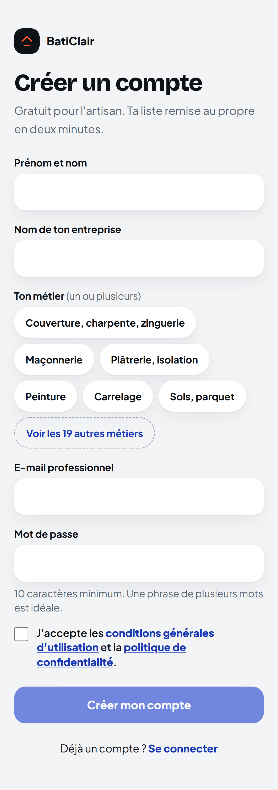 | 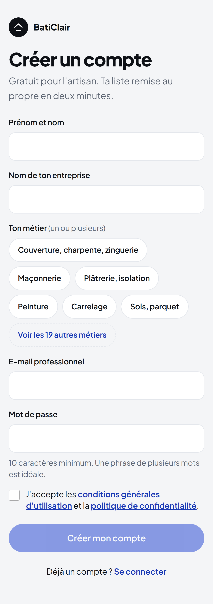 |
| Accueil vide | 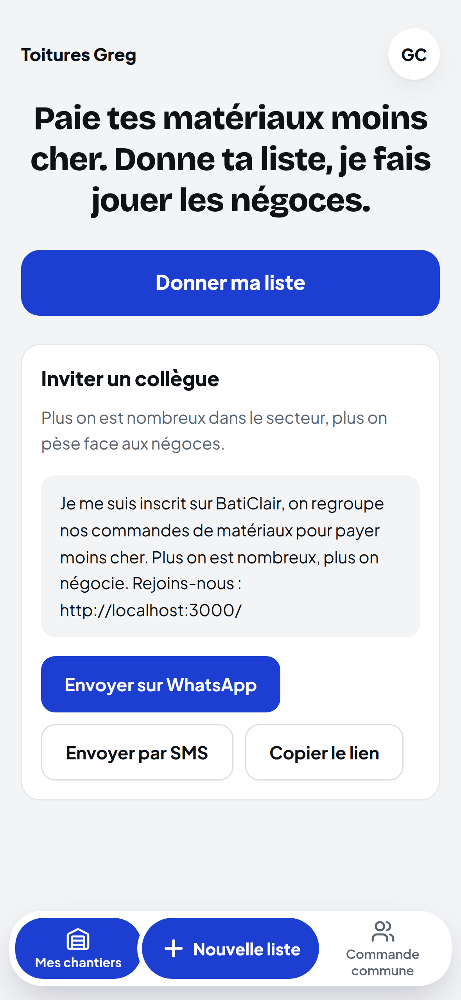 |  |
| Accueil | 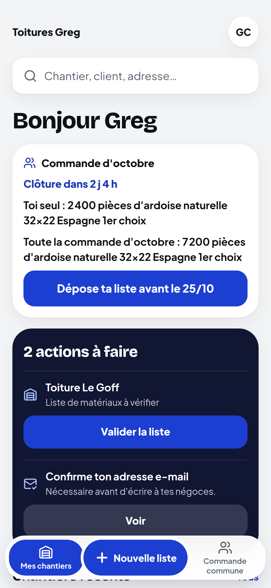 | 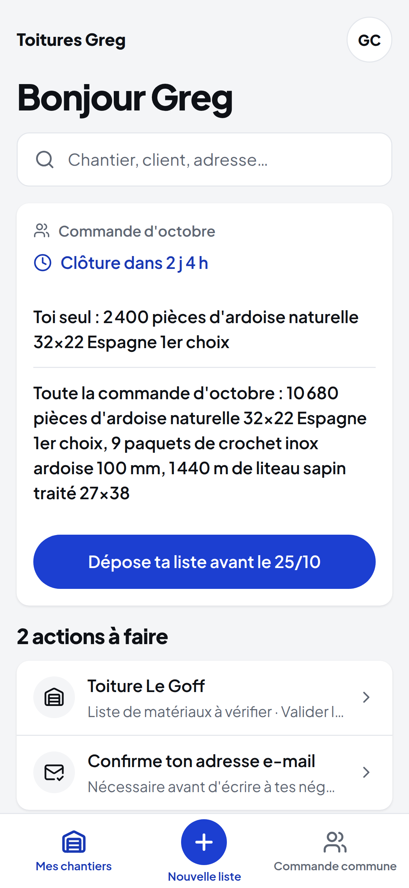 |
| Nouvelle liste | 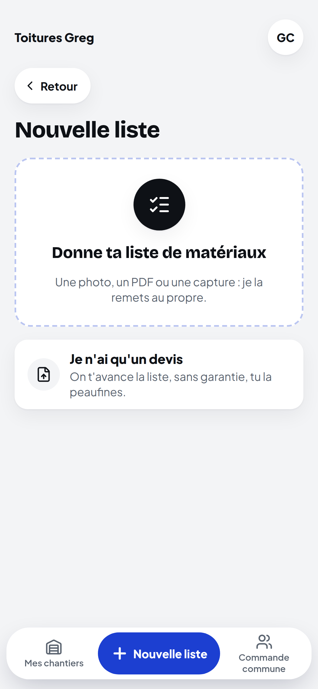 | 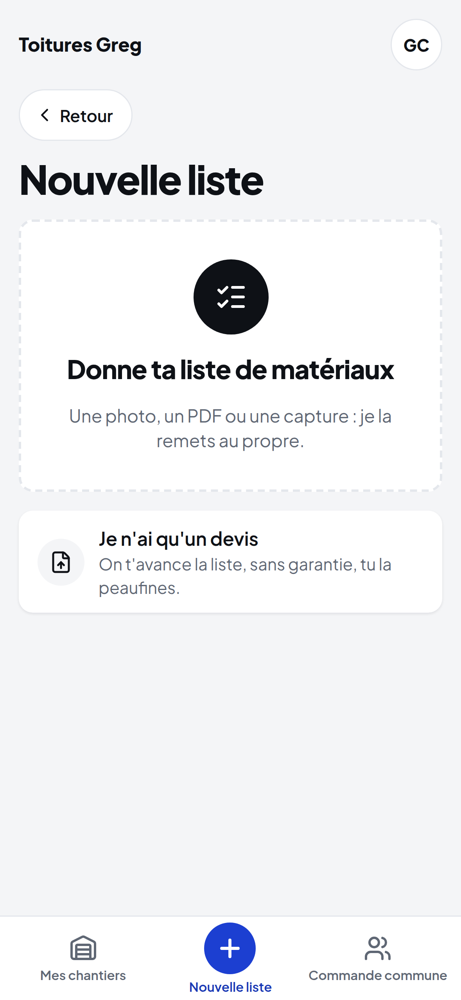 |
| Liste en cartes (Ton chantier) | 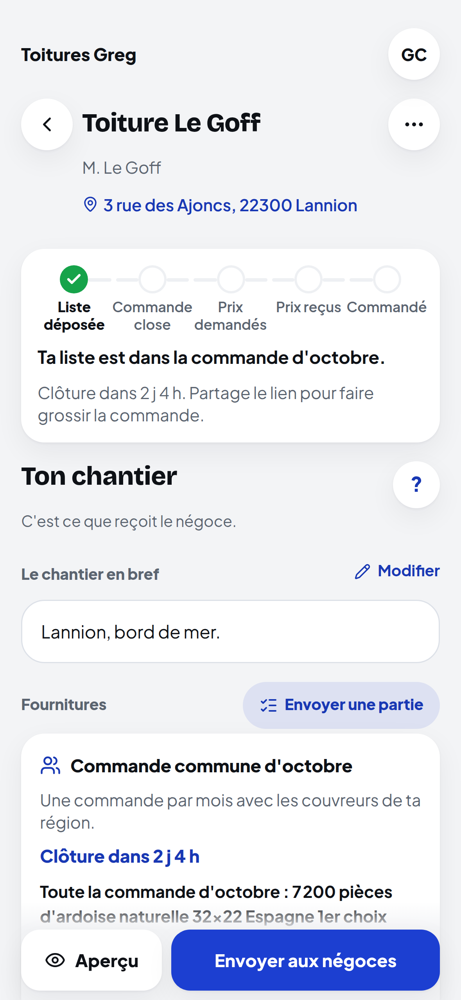 | 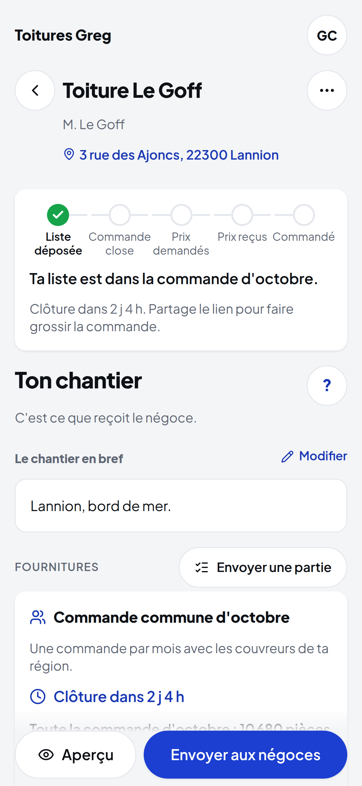 |
| Suivi façon colis (après clôture) | 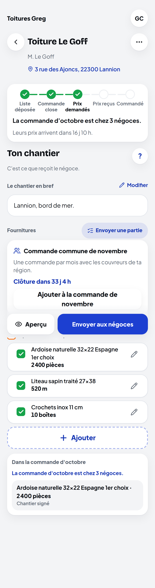 | 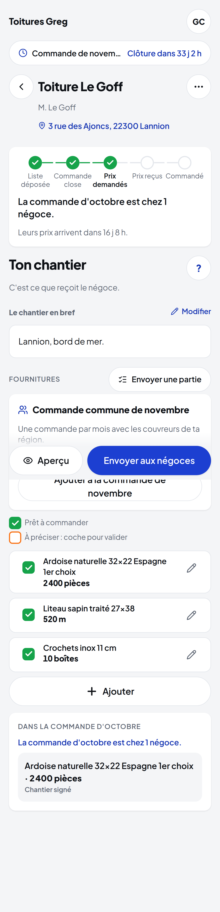 |
| Chantiers | 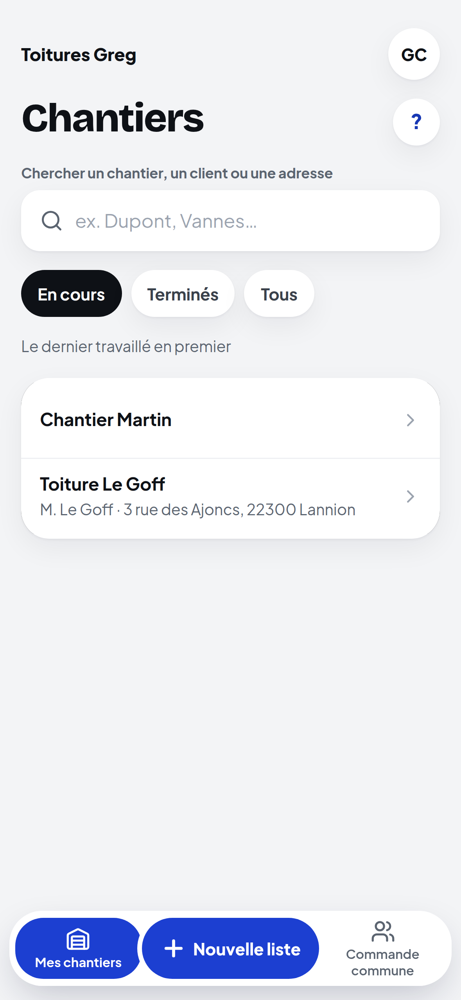 | 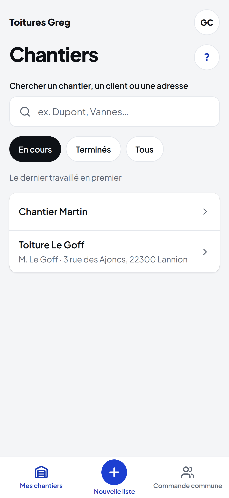 |
| Commande commune | 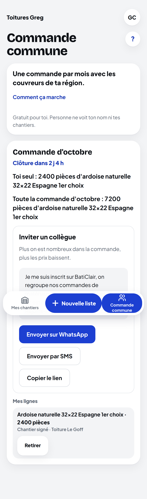 | 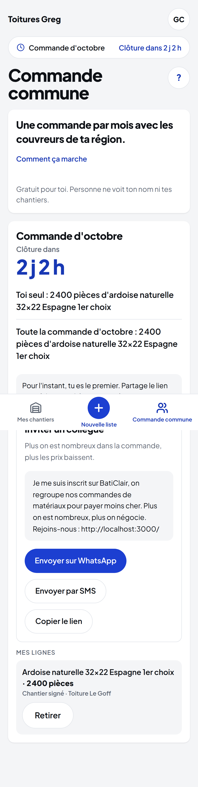 |
| Page négoce | 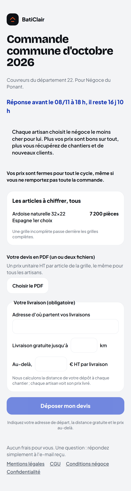 | 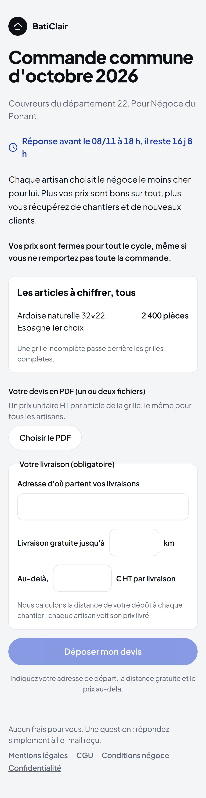 |
| Menu compte | 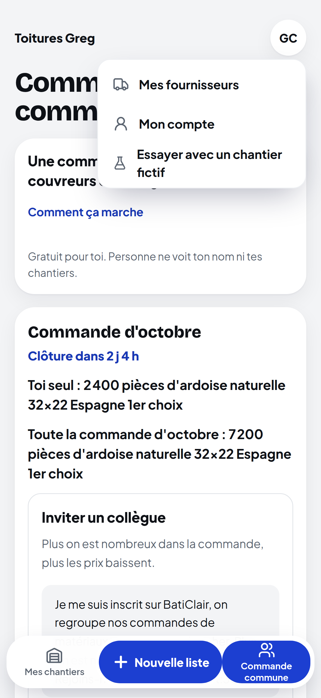 | 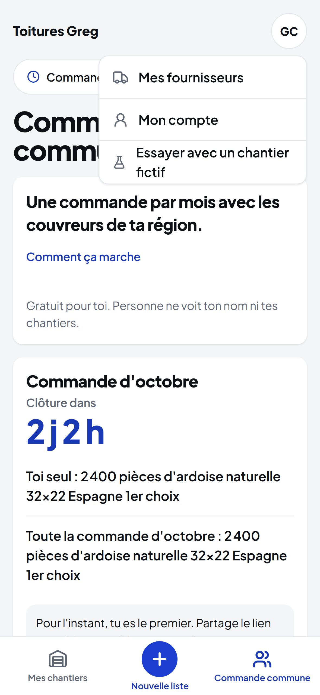 |
| Mon compte | 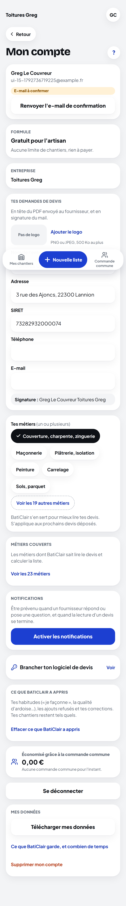 | 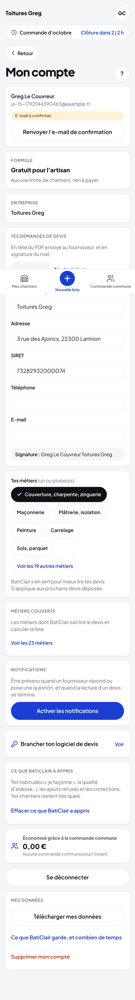 |
| Fournisseurs | 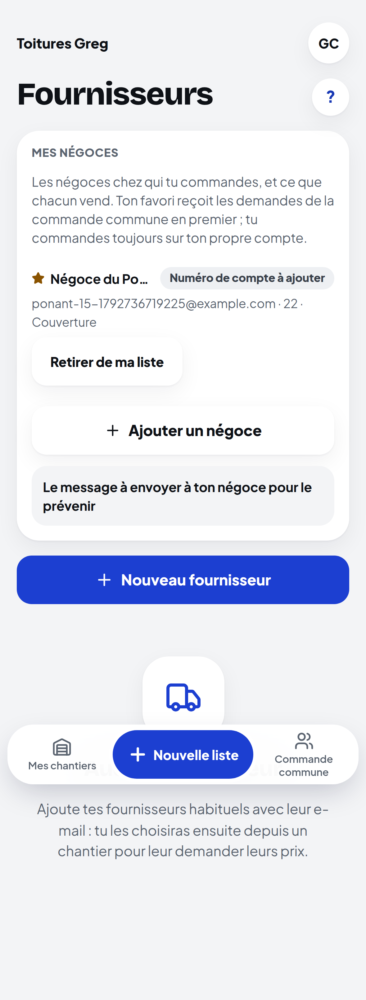 | 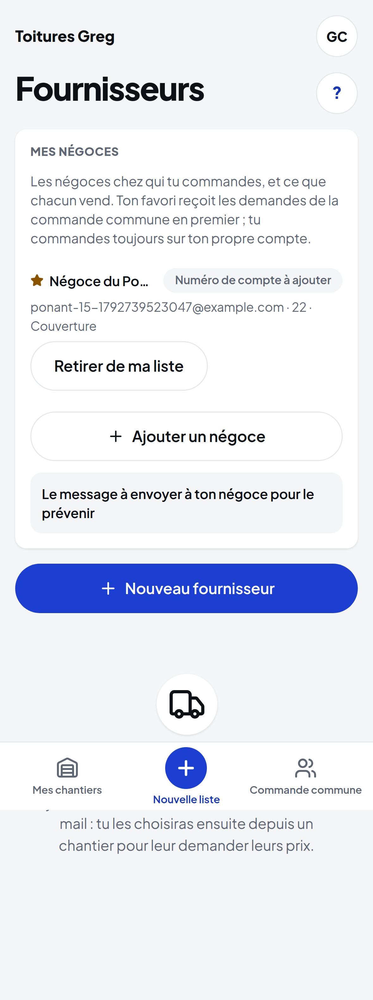 |

Les mêmes écrans sur iPhone SE : `captures/ui-23-10/avant/se/` et `captures/ui-23-10/apres/se/`.

### La landing, section par section

| Section | Avant | Après |
|---|---|---|
| Ordinateur, page entière | 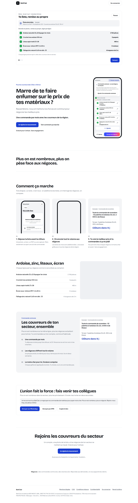 | 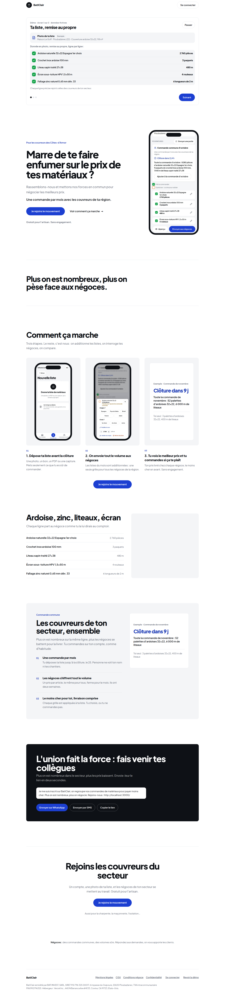 |
| iPhone SE, page entière |  |  |

- En-tête : logo en rond noir, « Se connecter » en contour rond.
- Accroche : 44 px sur téléphone, 64 px sur ordinateur, serrée ; le même bouton rond ; le téléphone de droite est un cadre iPhone (bordure, îlot) avec la liste « Ton chantier » de l'app d'après la passe (`public/landing/capture-liste.jpg`, régénérée).
- Compteur « Plus on est nombreux » : chiffre 72 à 96 px en accent.
- Comment ça marche : trois cadres iPhone avec un écran entier chacun (nouvelle liste, ligne à préciser) et le compteur de la commande ; plus de cadre coupé ni vide ; apparition douce au défilement (200 ms, opacité et 12 px, coupée sous « réduire les animations », aucun décalage).
- Ardoise, zinc, liteaux, écran : lignes séparées gris 2 ; l'emplacement photo n'apparaît qu'avec une photo (`PHOTOS_LANDING`).
- Les couvreurs de ton secteur : fond gris 1, compteur façon Qonto ; emplacement photo seulement avec une photo.
- L'union fait la force : une vraie section, noire, pleine largeur, titre 56 px sur ordinateur, WhatsApp en accent, SMS et lien en contour blanc.
- Rejoins les couvreurs du secteur : titre 56 px, bouton, ligne « Aussi pour… ».
- Négoces, pied de page : gris 3.

Lighthouse (12.8.2, site construit, API locale) :

| Page | Appareil | Performance | Accessibilité | LCP | Décalage |
|---|---|---|---|---|---|
| Landing | mobile (slow 4G simulé) | 96 | 100 | 2,7 s | 0 |
| Landing | ordinateur | 100 | 100 | 0,6 s | 0 |
| Connexion | mobile | 99 | 100 | 1,7 s | 0 (la place du formulaire est réservée) |
| Inscription | mobile | 100 | 100 | 1,7 s | 0 |

Gain principal sur la landing : la deuxième police (Bricolage Grotesque, 41 Ko) n'est plus chargée, les captures sont plus légères (JPEG 70).

### Tests

- Responsive (5 largeurs, écrans du mois, négoce, admin) : verts. e2e passe par défaut et passe `@lots` : lancés sur la version finale (résultat dans le message de fin de passe). Typecheck et lint verts (web et API).
- Aucun test n'a été modifié : là où un test tenait à une image ou un rôle (« Comment ça marche » : les trois images, le compteur en `role="img"`, zéro `svg` dans `main`), c'est le style qui s'est adapté.

### Ce que je n'ai pas osé toucher, et pourquoi

1. **Les couleurs d'état** (vert franc de la coche, orange vif du point, rouge d'erreur, fonds pâles) : règles produit §50 et §51.6, validées par Greg ; ce ne sont pas des couleurs de décoration.
2. **La ligne ouverte de « Ton chantier »** garde une ombre forte : c'est une carte au premier plan sur un fond flouté (retour de Greg, 11 octobre) ; sans ombre, on ne voit plus qu'elle est devant.
3. **Les scènes de lecture et de calcul** (`chantier-scenes.tsx` : le devis scanné, la liste qui se remplit) : animations validées (10 et 11 octobre), sur fond d'encre ; leurs ombres et leurs petits rayons servent le dessin, pas l'interface.
4. **Les écrans de l'ancien regroupement par lot** (mode `lots`, « Mes lots », barre de proposition) : ils prennent les nouveaux jetons (rayons, boutons, champs) mais n'ont pas été redessinés un par un ; Greg a choisi la commande du mois.
5. **Admin, formules (paywall), pages légales, aperçu PDF, chat** : mêmes jetons, pas de redessin ; le paywall est en pause, l'admin n'est vu que par Greg.
6. **Le retour haptique** : Safari iOS ne l'expose pas à une web app (`navigator.vibrate` absent) ; rien d'ajouté plutôt qu'un faux.
7. **Les paquets de polices** `@fontsource-variable/bricolage-grotesque` et `@fontsource/instrument-serif` restent dans `package.json` (plus chargés) : à retirer à la prochaine montée de dépendances, pour ne pas toucher au lockfile dans cette passe.
8. **Les emplacements photo** de la landing : plus d'aplat gris vide (retour de Greg sur l'iPhone, 23 octobre : « pas normal d'avoir des zones blanches ») ; l'emplacement n'apparaît que lorsqu'une photo est donnée dans `PHOTOS_LANDING`, et la mise en page se referme sans elle.
9. **Les textes** : aucun mot changé, y compris les libellés des boutons et des étapes.

### Retour de Greg sur la prévisualisation (23 octobre, 9 h 28)

Deux zones vides sur l'iPhone : la carte de la commande du mois sur l'accueil, et l'emplacement photo de la landing.

- La carte : c'était le squelette de chargement, resté affiché parce que l'appel `/v1/commande-du-mois` échoue sur la prévisualisation. Cause : le site de prévisualisation relaie `/v1/*` vers l'API de production (`API_URL`, projet Vercel `baticlair-api`, code de `main`), qui n'a pas la commande du mois ; c'est aussi pour cela que « 3 offres reçues · Comparer les offres » réapparaît (le filtre des actions est dans l'API de la branche). Corrigé côté écran : le squelette ne s'affiche que pendant le chargement, jamais sur une erreur. Pour voir la commande du mois en vrai sur la prévisualisation, il faut une API déployée depuis la branche et `API_URL` du site de prévisualisation pointé dessus (LANCEMENT, point 5).
- L'emplacement photo : retiré tant qu'il n'y a pas de photo.

### Retour de Greg (23 octobre, 10 h) : « je ne vois pas de minuteur ; n'importe qui doit comprendre en 10 secondes »

- **Le minuteur est partout et toujours là.** Sur l'accueil, en très grand (« Clôture dans **2 j 2 h** », 40 px) dans le bloc de la commande du mois, avec la règle en une phrase et les trois étapes ; sur chaque autre écran, un bandeau sous l'en-tête (« Commande d'octobre · Clôture dans 2 j 2 h ») qui mène à l'onglet ; dans l'onglet et sur « Ton chantier », le même chrono. Il se recalcule toutes les 30 secondes dans le navigateur.
- **Quand l'API ne répond pas** (prévisualisation reliée à l'API de production, panne), l'écran calcule la prochaine clôture avec la règle par défaut du domaine (le 1er et le 15 à 12 h, heure de Paris, cycle raccourci du 23 octobre : `apps/web/src/lib/cycle.ts`) : le minuteur et le bouton « Dépose ta liste avant le 15/10 » sont là quoi qu'il arrive ; seules les quantités (« Toi seul », « Toute la commande ») attendent l'API.

## 6. Ultra intuitif (27 octobre 2026) : une question par écran

Greg, après l'achat groupé v2 : « C'est pas assez intuitif ! J'ai du mal à comprendre tellement y a d'info. Rend l'interface de l'artisan et du négoce ultra intuitive. » Règle appliquée partout : UN écran = UNE question et UN bouton ; les explications derrière un tap ; les textes de Greg (phrase d'engagement B6, les quatre règles B9, les titres, H30 / H31) inchangés. Captures avant / après : `docs/groupe/captures/intuitif-27-10/avant/` et `apres/` (iPhone, pleine page).

| Écran | Avant | Après |
|---|---|---|
| Deux portes (accueil, feuille du « + ») | Deux lignes de sous-titre par porte. | Un titre, trois mots (« Plus nombreux, moins cher. », « Devis, photo, ou à la main. »), un chevron. |
| Onglet « Achats groupés » | Paragraphe d'explication sous le titre, état vide en deux phrases. | Le titre et le bouton ; état vide en une phrase. |
| Carte d'un achat ouvert | La phrase de l'alerte (deux phrases), le nombre d'entreprises, la jauge, le bouton. | « Ajoute ta liste avant le 12 novembre. Livraison avant le 26 novembre. », la jauge, le bouton. |
| Ajouter ma liste (`lancer`) | Une page : catalogue, lignes, commune, date, négoces, règles, case, bouton, tout à la suite. | QUATRE ÉTAPES (`Etape`, barre de progression, chevron retour) : 1 « Qu'est-ce que tu commandes ? » ; 2 « Où et pour quand ? » ; 3 « À quels négoces envoyer la demande ? » ; 4 « Ton engagement » (les quatre règles en lignes cochées, la case, « offert », le bouton). Un seul bouton par étape, « Continuer » grisé tant que l'étape n'est pas remplie ; un rappel d'une ligne de ce qui précède. |
| Acheter en groupe (depuis une liste) | La même page longue dans une carte, sous la liste. | Les mêmes quatre étapes, dans la carte : les lignes à cocher, puis l'achat ouvert ou la date et la commune, puis les négoces, puis l'engagement. |
| Détail d'un achat groupé | Titre, carte d'état, frise, « Ma liste » ouverte avec les négoces, « Modifier », « Retirer », les deux motifs de sortie toujours affichés, « Préviens », « Invite-le ». | Titre, carte d'état AVEC la frise, la prochaine action (offres, bon, Livré / Problème, plan B, « Préviens ton négoce » tant qu'on attend), « Ma liste » REPLIÉE (un tap : les lignes, « Modifier mes quantités », les négoces en une ligne), puis en bas, en texte discret, « Retirer ma liste » et « Sortir de l'achat groupé » ; les motifs n'apparaissent qu'après « Sortir », avec « Finalement, je reste ». « Invite-le » seulement tant qu'on attend. |
| Les offres | Toutes les offres en cartes égales, le texte de consentement complet, trois boutons par offre. | La meilleure offre en grand (bordure jaune, prix 22 px, UN bouton jaune) ; les autres repliées sous « Les N autres offres » ; consentement en une phrase ; « J'ai déjà un compte : commander » en lien. |
| Préviens ton négoce | Le SMS en clair sous les cartes. | Le SMS replié (« Le SMS envoyé »). |
| Page du négoce (`achat-groupe/[jeton]`) | « À savoir » (cinq puces), les lignes, délai, PDF, le cadre des conditions d'ouverture (sept cases), la case, le bouton. | L'écran, c'est la liste : un prix par ligne (bordure verte dès qu'une ligne est répondue, « 1 / 2 »), puis « Déposer mon offre ». Derrière un tap : « Les règles de cette demande » (dans la carte du haut), « Plutôt votre devis PDF ? » (PDF et délai), « Pour ouvrir un compte chez vous » (résumé « 3 conditions cochées, une fois pour toutes »). |

Ce qui n'a pas bougé : les mots validés (phrase d'engagement, règles, motifs de sortie, « Je ne fournis pas », titres), les routes, l'API, le domaine, les e-mails. e2e `achat-groupe.spec.ts` et la recette en ligne suivent les étapes (« Continuer »).
